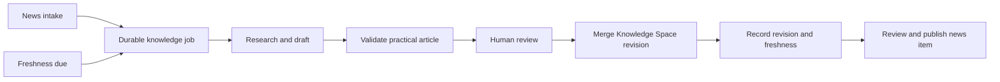

# News-Entwicklungsgraph {#news-development-graph}

## Vertragsumfang {#contract-scope}

Das Happyin-News-System Schema 1.4 verbindet jeden geprüften News-Datensatz mit einem Projekt- oder Organisations-Entwicklungsstrang sowie mit einer agentenlesbaren Knowledge-Space-Ressource. Die Datensätze der Schemata 1.2 und 1.3 bleiben gültig und werden nicht nachträglich semantischen Zweigen zugeordnet.

Vier Repositories verantworten jeweils eine eigene Stufe:

| Repository | Verantworteter Zustand |
|---|---|
| `diffusion-love` | Private Skelette, Provider-Läufe, Belege, Review-Entscheidungen, Export-Gate |
| `diffusion-love-news` | Öffentliche kanonische Einträge, JSON Schema, deterministische Indizes |
| `diffusion-love-web` | Schreibgeschützter Feed sowie Darstellung von Projekten, Organisationen und Einträgen |
| `knowledge-space` | Dichte öffentliche Implementierungsreferenzen und Agent Briefs |

Die Abhängigkeitsrichtung verläuft nur in eine Richtung: Der private Exporter gibt einen geprüften öffentlichen Eintrag aus, der öffentliche Builder validiert und materialisiert ihn, und sowohl das Portal als auch Agenten nutzen den resultierenden öffentlichen Snapshot. Das Portal schreibt nie Identitäts- oder Graphzustand.

## Implementierungsrevisionen {#implementation-revisions}

Der öffentliche Producer-Vertrag ist auf [`cd94753d11a86102df942f5560f1f49cdf332ccc`](https://github.com/AnastasiyaW/diffusion-love-news/commit/cd94753d11a86102df942f5560f1f49cdf332ccc) festgelegt. Diese Revision ergänzt die Validierung von Schema 1.4, Abstammungsprüfungen über mehrere Datensätze hinweg, die Aggregation von Projekt-Strängen und `_organizations.json`, während alle 329 älteren kanonischen Einträge semantisch unverändert bleiben.

Portalquellcode und Deployment können zugriffsbeschränkt sein; deshalb stellt dieser Artikel sie nicht als öffentlich abrufbare Belege dar. Der Consumer-Vertrag ist normativ: Ein konformer Consumer muss dieselben Identitäten und Kanten fail-closed validieren und News-, Projekt- und Organisationsrouten aus einem einzigen, unveränderlichen Producer-Snapshot rendern.

## Öffentliche Entitäten {#public-entities}

### Projekt {#project}

`project.family_slug` bleibt die stabile Projektidentität. Modellversionen und Anpassungen bleiben innerhalb derselben Familie. Ältere Projektseiten verwenden weiterhin `_projects.json`.

### Organisation {#organization}

`organization.slug` ist die stabile Identität des Unternehmens bzw. des Eigentümers. Ein Projekteintrag darf sowohl Projekt als auch Organisation enthalten; deren Vendor-Slug und Anzeigename müssen übereinstimmen. Reine Unternehmensnews dürfen ein anonymes Projektobjekt verwenden, müssen aber die Organisationsidentität beibehalten.

### Entwicklungsstrang {#development-thread}

`development` enthält:

```json
{
  "scope": "project",
  "thread_slug": "news-knowledge-graph",
  "thread_display": "News and knowledge graph",
  "predecessor_ids": ["n-0123456789"]
}
```

`scope` wählt das Projekt oder die Organisation desselben Eintrags aus. Vorgänger sind geprüfte Fortsetzungskanten, keine Ähnlichkeitsergebnisse. Der öffentliche Builder prüft, dass jeder Vorgänger existiert, in der deterministischen Chronologie früher liegt und denselben Gegenstand und Strang hat.

Der Builder materialisiert `development_threads` für Projekte und eine separate `_organizations.json`. So kann eine Projektseite parallele Entwicklungslinien anzeigen und eine Organisationsseite direkte Meilensteine des Unternehmens mit den ausdrücklich zugeordneten Projekten zusammenführen.

## Knowledge-Space-Brücke {#knowledge-space-bridge}

Jeder Eintrag im Schema 1.4 enthält genau ein geprüftes `knowledge`-Objekt:

```json
{
  "title": "News Development Graph",
  "article_url": "https://happyin.space/architecture/news-development-graph/",
  "source_url": "https://raw.githubusercontent.com/AnastasiyaW/knowledge-space/FULL_COMMIT_SHA/docs/architecture/news-development-graph.md",
  "agent_context_url": "https://happyin.space/architecture/news-development-graph/#agent-brief"
}
```

Die gerenderte Seite dient Menschen als stabile Navigation. `source_url` muss auf einen vollständigen Git-Commit fixiert sein, damit ein Agent denselben Artikel liest, der zusammen mit dem News-Datensatz geprüft wurde. `agent_context_url` verweist auf die unten stehende, direkt kopierbare Anweisung.

Dieser öffentliche Agent Brief ist kein Provider-Prompt. Interne Anreicherungs-Prompts, rohe Provider-Ausgaben und Review-Notizen bleiben privat und werden vom öffentlichen Feed-Builder rekursiv abgewiesen.

## Laufzeitstatus {#runtime-status}

Stand 2026-08-26 funktioniert die geprüfte öffentliche Brücke für den ersten Eintrag im Schema 1.4:

- der Eintrag gehört zum Entwicklungsstrang des Projekts `diffusion-love`;
- sein Knowledge-Space-Markdown ist auf einen unveränderlichen Git-Commit fixiert;
- das Portal kann den Projektstrang sowie die Aktionen für Artikel/Agent Brief darstellen;
- private Anreicherungsläufe, Review-Entscheidungen und der öffentliche Export werden protokolliert.

Der nächste Wartungszyklus ist **konzipiert, aber noch nicht implementiert**. Die aktuelle private Datenbank enthält keine Tabellen für Knowledge-Space-Ressourcen, Refresh-Jobs, Artikelprüfungen oder Revisionen. `FRESHNESS.md` legt domänenbezogene Prüfintervalle fest, doch der aktuelle Freshness-Checker validiert Repository-Zahlen, Wiki-Links und die Synchronisation von `llms.txt`, nicht das Datum der letzten Prüfung jedes Artikels.

Diese Unterscheidung ist betrieblich relevant: Ein verlinkter unveränderlicher Artikel belegt, was zusammen mit einem News-Eintrag geprüft wurde; er belegt nicht, dass ein Agent den Artikel seitdem auf neuere Informationen geprüft hat.

## Zielzyklus News-zu-Knowledge {#target-news-to-knowledge-cycle}

Jede angenommene News-Aufnahme nach Schema 2 verwendet eine vom Kurator verantwortete Referenz auf eine Knowledge-Space-Ressource und legt in derselben privaten Datenbanktransaktion wie die Ressourcenbindung und der News-Eintrag genau einen idempotenten Job an. Das endgültige öffentliche `knowledge`-Objekt wird erst materialisiert, nachdem eine genehmigte Knowledge-Space-Revision einen vollständigen Git-SHA liefert. Ein Kalender-Scheduler erstellt denselben Jobtyp, sobald ein Artikel seinen nächsten Prüftermin erreicht; der Workflow hängt damit nicht davon ab, dass weiterhin News eingehen.



Der Job ist der dauerhafte Auslöser. Ein MCP-Aufruf, eine Modellkonversation oder eine Browser-Sitzung kann enden, ohne dass die Arbeit verloren geht.

Das private Journal benötigt fünf Arten von Zustand:

| Datensatz | Aufgabe |
|---|---|
| Knowledge-Ressource | Stabile Identität von Projekt- bzw. Organisation/Strang zu Artikel sowie aktuelle Freshness-Projektion |
| News-Bindung | Genaue Beziehung von Eintrag zu Ressource und genehmigter Revision |
| Knowledge-Job | Auslöser (News, geplant oder manuell) sowie Workflow-Status und Deduplizierungsschlüssel |
| Knowledge-Lauf | Nur anhängbarer Agent-/Provider-Versuch mit Hashes und Verweis auf Belege |
| Knowledge-Revision | Vorheriger/neuer Git-SHA, geänderte Pfade, Prüfer und Merge-Nachweis |

Die Ressourcenidentität ist eindeutig über `(subject_scope, subject_slug, thread_slug)`, wobei `subject_scope` entweder `project` oder `organization` ist. Eine News-Bindung muss mit dem kanonischen Entwicklungsgegenstand und Strang des Eintrags übereinstimmen. So kann auch Unternehmensnews denselben Zyklus auslösen, ohne vorzugeben, das Unternehmen sei ein zwischengeschaltetes Projekt.

Auch eine Prüfung ohne Änderungen ist ein Beleg. Sie aktualisiert `last_checked_at` und den nächsten Prüftermin, erzeugt aber keinen leeren Git-Commit und ändert `last_changed_at` nicht. Ein fehlgeschlagener Lauf erhöht die Aktualität nie. Historische News-Einträge behalten ihre alte, per Commit adressierte Quelle, selbst wenn der Live-Artikel später eine geplante Revision erhält.

## Praxisnaher Nutzungsvertrag {#practical-use-contract}

Eine mit News verknüpfte Wissensseite muss einem Ingenieur oder Agenten erklären, wie die Änderung anzuwenden ist, und nicht nur die Ankündigung beschreiben. Das geplante Review-Gate verlangt:

1. was sich geändert hat und welche Projekt- oder Unternehmensentwicklungslinie fortgeführt wird;
2. einen ausführbaren Befehl, API-Aufruf, Workflow oder eine exakte Abfolge von Bedienschritten;
3. wann es einzusetzen und wann nicht einzusetzen ist;
4. Versionen, Voraussetzungen, Kompatibilitätsgrenzen und Fehlerszenarien;
5. Implementierungsdetails, die in geprüften Quellen belegt sind;
6. mindestens zwei konkrete Fallstricke;
7. einen Agent Brief und exakte Quellrevisionen.

Modelle dürfen diese Abschnitte entwerfen. Sie können weder die kanonische Projekt-/Strang-Identität festlegen, ihre eigene Ausgabe als geprüft markieren, noch eine Revision veröffentlichen.

## MCP-Grenze {#mcp-boundary}

MCP ist hier als typisierte Agentenschnittstelle nützlich, ist aber weder Datenbank, Scheduler noch Workflow-Engine.

Das minimale Design verwendet zwei fokussierte Oberflächen:

### Öffentlicher `happyin-context` {#public-happyin-context}

Ein schreibgeschützter, zustandsloser Streamable-HTTP-Server stellt per Commit adressierte News-, Projekt-, Knowledge-Space- und Freshness-Ressourcen bereit. Zielorientierte Tools durchsuchen News/Wissen, stellen einen Projektkontext zusammen und erstellen einen kompakten Agentenkontext für eine News-ID. Jedes Ergebnis enthält die exakten SHAs von Producer und Knowledge Space. Er gibt keinen privaten Review-Status und kein generisches Fetch- oder Shell-Tool preis.

Der Zielendpunkt ist `https://mcp.happyin.space/mcp`. Er ist im betrieblichen Sinn öffentlich: Jede Person und jeder Agent kann seine schreibgeschützten Tools ohne Login, OAuth, API-Schlüssel, benutzerdefinierte Header oder Cloudflare Access auflisten und aufrufen. Das Deployment liest ausschließlich bereinigte öffentliche Artefakte und besitzt weder Bindung noch Zugangsdaten für die private Datenbank, Rohaufnahmen, Reviews, Entwürfe oder Veröffentlichungsoperationen. Begrenzte Ein- und Ausgaben, Caching, Timeouts und sichtbare `429`-Antworten schützen den anonymen Dienst, ohne Ratenbegrenzungen zu einem Identitätssystem zu machen.

### Privates `happyin-curation` {#private-happyin-curation}

Der erste schreibende Server ist ein lokaler `stdio`-Server neben der Python-Pipeline, der privaten SQLite-Datenbank und den Git-Worktrees. Typisierte Tools können Aufgaben auflisten, einen idempotenten Refresh einreihen, einen Entwurf vorbereiten, eine menschliche Prüfung erfassen, eine genehmigte Knowledge-Space-Revision anwenden, einen News-Kandidaten zusammenstellen und einen genehmigten Kandidaten veröffentlichen. Anwende- und Veröffentlichungsaktionen bleiben jeweils separat freigabepflichtig.

Lang laufende Arbeit wird über die fachliche `job_id` identifiziert. Die MCP-Tasks-Erweiterung darf diesen Job nur spiegeln, wenn der Server die Erweiterung ankündigt und der Client über die Capabilities in den `_meta` der jeweiligen Anfrage zustimmt. Das Task-Handle wird dauerhaft gespeichert und vor der Rückgabe dem fachlichen Job zugeordnet; das Abfragen des dauerhaften Jobs bleibt der Kompatibilitätsweg. Zustand über mehrere Aufrufe hinweg wird explizit geführt und nicht in einer unsichtbaren Protokollsitzung gehalten.

Externe Webseiten und Provider-Antworten sind nicht vertrauenswürdige Daten. Sie dürfen Fakten stützen, aber Berechtigungen, Identitäten, Tool-Auswahl oder Freigabestatus nicht ändern. Tool-Ausgaben sind strikte, begrenzte Objekte mit Belegverweisen und benannten gültigen nächsten Aktionen.

Für die erste private Verbindung verwenden Sie Antigravity IDE mit einer workspace-lokalen `.agents/mcp_config.json` oder Antigravity CLI für denselben lokalen `stdio`-Server. So bleibt der Kurationsprozess neben seiner SQLite-Datenbank und den Git-Worktrees, während die Verbindungsprotokolle prüfbar bleiben. Antigravity ist nur der MCP-Client; er besitzt keinen Jobzustand. Sobald der öffentliche schreibgeschützte Endpunkt deployt ist, können Antigravity 2.0, IDE und CLI alle über dessen remote `serverUrl` verbunden werden.

Nach dem Start benötigt ein Antigravity-Nutzer nur:

```json
{
  "mcpServers": {
    "happyin-context": {
      "serverUrl": "https://mcp.happyin.space/mcp"
    }
  }
}
```

Das Release veröffentlicht außerdem Konfigurationen zum Kopieren, `server.json` und einen Eintrag in der MCP Registry. Die Website bleibt die stabile Auffindungsquelle, solange die offizielle Registry in der Vorschau ist.

## Aktuelle Veröffentlichungsreihenfolge {#current-publication-sequence}

Bis das oben beschriebene Ziel für Schema 2 implementiert ist, bleibt die laufende Laufzeitumgebung artikelzuerst:

1. Knowledge-Space-Artikel schreiben und validieren.
2. Ihn mergen und die exakte, per Commit adressierte Markdown-URL festhalten.
3. Ein News-Skelett mit Projekt-/Organisations-, Entwicklungs- und Knowledge-Referenzen einspielen.
4. Nur über einen ausdrücklich ausgewählten Provider oder einen geprüften manuellen Belegelauf anreichern.
5. Den vollständigen öffentlichen Kandidaten zusammenstellen und prüfen.
6. Eine ausdrückliche menschliche Review-Entscheidung festhalten.
7. Den kanonischen Eintrag exportieren und alle generierten öffentlichen Indizes neu aufbauen.
8. Den exakten Producer-Commit, die CI-Validierung und die authentifizierten Portalrouten prüfen.

Allein das Veröffentlichen des Artikels veröffentlicht noch keinen News-Eintrag. Allein das Exportieren eines privaten Kandidaten aktualisiert den öffentlichen Feed nicht. Eine über einen Branch adressierte CDN-Antwort ist kein Beleg für einen einheitlichen Snapshot.

## Agent Brief {#agent-brief}

Kopieren Sie diese Anweisung zusammen mit der relevanten Happyin-News-URL an einen Agenten:

```text
Read the linked Happyin news item and this Knowledge Space article. Treat the
news item's project, organization, development thread, predecessor IDs and
commit-addressed knowledge source as the authoritative public graph. Explain:
1. what changed;
2. which project or company development line it continues;
3. how a user or agent can apply the changed capability, including prerequisites,
   an exact operating sequence and the main failure modes;
4. how the implementation works across the private pipeline, public builder,
   portal and Knowledge Space;
5. which claims are verified, reported or inferred;
6. the exact source revisions that support the answer.

Do not infer missing graph edges from similar titles, tags or embeddings. Do
not treat a mutable branch URL or a current live page as historical proof. If
the immutable source or referenced predecessor cannot be retrieved, state the
missing evidence instead of filling the gap.
```

## Validierungsregeln {#validation-rules}

- Identitäts-Slugs sind kleingeschriebenes Kebab-Case und werden vor dem Export geprüft.
- Ein Entwicklungsstrang gehört genau einem Projekt oder einer Organisation.
- Kanten zu Vorgängern, die gegenstands- oder strangübergreifend, fehlend oder vorwärtsgerichtet sind, werden fail-closed abgewiesen.
- Knowledge-Markdown verwendet eine unveränderliche vollständige Git-Commit-URL.
- Der öffentliche Feed enthält URLs zum Agentenkontext, niemals internen Prompt-Text.
- Abgeleitetes JSON wird aus den Eintragsdateien neu erzeugt und nicht manuell bearbeitet.

## Fallstricke {#gotchas}

- **Ähnliche News sind keine Fortsetzung:** Suche und Embeddings können eine Kandidatenkante vorschlagen. **Abhilfe:** Veröffentlichen Sie nur vom Reviewer genehmigte Vorgänger-IDs.
- **Ein Firmenname ist keine Identität:** Schreibweise und Markenänderungen erzeugen doppelte Seiten. **Abhilfe:** Verwenden Sie genau einen kanonischen Organisations-Slug und lehnen Sie widersprüchliche Metadaten bei der Aggregation ab.
- **Eine stabile Webseite ist keine unveränderliche Eingabe:** Ihr Inhalt kann sich nach einer News-Prüfung ändern. **Abhilfe:** Koppeln Sie die Seite mit einem per Commit adressierten Markdown.
- **Agentenkontext kann mit Anreicherungs-Prompts verwechselt werden:** Das Lockern von Datenschutzprüfungen würde interne Daten offenlegen. **Abhilfe:** Verbieten Sie interne Prompt-Schlüssel weiterhin und veröffentlichen Sie nur die geprüften Artikel-URLs.

## Siehe auch {#see-also}

- [[news-research-knowledge-lifecycle]]
- [[happyin-knowledge-space]]
- [[architecture-documentation]]
- [[data-serialization-formats]]
- [[agent-architectures]]
- [[transactional-outbox]]
- [[function-calling]]

## Protokollreferenzen {#protocol-references}

- [MCP-Release 2026-07-28](https://blog.modelcontextprotocol.io/posts/2026-07-28/)
- [MCP-Tasks-Erweiterung](https://github.com/modelcontextprotocol/modelcontextprotocol/blob/main/docs/extensions/tasks/overview.mdx)
- [Offizielles MCP-Python-SDK v2](https://py.sdk.modelcontextprotocol.io/)
- [Cloudflare-Leitfaden für Remote-MCP](https://developers.cloudflare.com/agents/model-context-protocol/guides/remote-mcp-server/)
- [Cloudflare-Steuerung für öffentliche MCP-Endpunkte](https://developers.cloudflare.com/ai-search/how-to/connect-mcp-client/)
- [MCP-Integration im OpenAI Agents SDK](https://openai.github.io/openai-agents-python/mcp/)
- [MCP-Konfiguration für Google Antigravity](https://antigravity.google/docs/mcp)
- [Remote-Server in der MCP Registry](https://modelcontextprotocol.io/registry/remote-servers)
