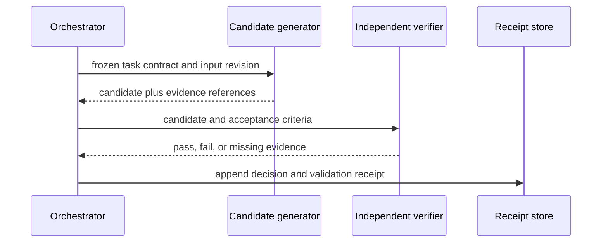
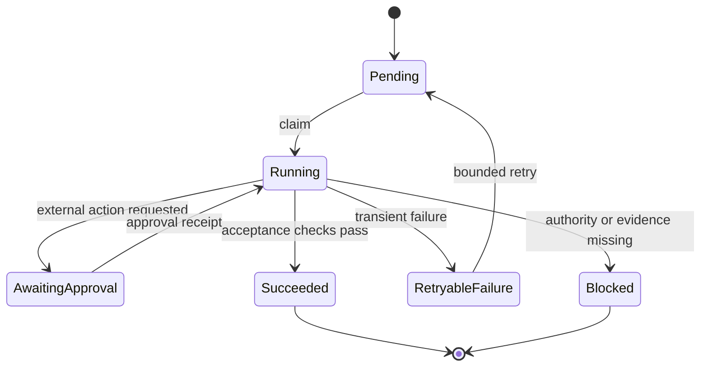

# Diagramme als Code für Agenten-Workflows {#diagram-as-code-for-agent-workflows}

**Stand der Prüfung: 2026-09-04.** Ein Diagramm ist dann wertvoll, wenn es einen sonst verborgenen Zustandsübergang, eine Übergabe, eine Freigabe oder eine Vertrauensgrenze nachvollziehbar macht. Bewahren Sie den Diagrammquelltext zusammen mit dem System auf, das er beschreibt, aber gehen Sie nicht davon aus, dass ein Markdown-Renderer, eine Hosting-Plattform oder eine Notation jedes Diagrammmerkmal unterstützt.

## Die unklare Grenze darstellen {#diagram-the-unclear-boundary}

Beginnen Sie mit einer konkreten Frage statt mit einem Diagrammtyp:

| Frage | Kleinstes nützliches Diagramm |
|---|---|
| Welche Rolle sendet welches Artefakt und in welcher Reihenfolge? | Sequenzdiagramm |
| In welche Zustände kann eine Aufgabe gelangen, in denen sie wiederholt wird oder endgültig fehlschlägt? | Zustandsdiagramm |
| Welche Komponente darf welches Tool oder welchen Dienst aufrufen? | Kontext- oder Vertrauensgrenzen-Diagramm |
| Welche Daten überschreiten eine Berechtigungs-, Mandanten- oder Netzwerkgrenze? | Datenfluss- oder Deployment-Diagramm |
| Welche Richtlinie steuert eine Entscheidung? | Entscheidungstabelle, optional kombiniert mit einem Zustandsdiagramm |

Zeichnen Sie keinen trivialen Helfer nur deshalb als Diagramm, weil ein Diagrammwerkzeug verfügbar ist. Bevorzugen Sie einen einfachen Test, einen Vertrag oder eine kurze Tabelle, wenn diese das Verhalten direkter vermitteln.

## Sequenzdiagramm: Übergaben sichtbar machen {#sequence-diagram-make-handoffs-visible}

Dieses Mermaid-Beispiel erfasst einen begrenzten Review-Ablauf. Es beschreibt das beabsichtigte Protokoll; der referenzierte Code und die Tests müssen weiterhin belegen, dass das Protokoll implementiert ist.

Sequenzdiagramme sind dann wirkungsvoll, wenn die Reihenfolge der Nachrichten relevant ist. Sie sollten das übergebene Artefakt benennen und nicht bloß das Agentenlabel. Mermaid dokumentiert die Syntax von Sequenzdiagrammen; PlantUML behandelt textuelle Teilnehmer- und Nachrichtendefinitionen ebenfalls als Quelltext, den ein Renderer in ein Diagramm umwandelt. [Mermaid-Sequenzdiagramme](https://mermaid.js.org/syntax/sequenceDiagram) · [PlantUML-Sequenzdiagramme](https://plantuml.com/sequence-diagram)

## Zustandsdiagramm: Endzustände explizit machen {#state-diagram-make-terminal-states-explicit}

Für Agenten ist ein Zustandsdiagramm oft nützlicher als ein großes Klassendiagramm, da Wiederholungen, Freigaben und endgültige Fehlerzustände operativ wichtig sind.

Ein terminaler Zustand „blocked“ ist kein Fehler, der hinter einer Wiederholungsschleife verborgen liegt. Er zeigt Betreibern, welcher Nachweis, welche Freigabe oder welche externe Bedingung erforderlich ist, bevor die Arbeit fortgesetzt werden darf. Prüfen Sie die exakte Zustandssyntax gegen den Renderer in Ihrer Dokumentationspipeline. [Mermaid-Zustandsdiagramme](https://mermaid.js.org/syntax/stateDiagram.html) · [PlantUML-Zustandsdiagramme](https://plantuml.com/state-diagram)

## Vertrauensgrenzen getrennt halten {#keep-a-trust-boundary-separate}

Ein Workflow-Diagramm kann Berechtigungen implizieren, ohne sie zu zeigen. Ergänzen Sie für Entscheidungen, die Zugangsdaten, Nutzerdaten, Netzwerkaufrufe oder Veröffentlichung betreffen, eine kompakte Grenzansicht oder Tabelle.

| Grenze | Erlaubter Fluss | Erforderlicher Nachweis |
|---|---|---|
| Nutzereingabe zum Planer | als nicht vertrauenswürdige Daten lesen | Eingabeprotokoll und Richtlinienversion |
| Planer zum Tool-Runner | nur deklarierte Tool-Parameter | Berechtigungsentscheidung und Tool-Beleg |
| Tool-Runner zu externem Dienst | genehmigte, eingegrenzte Anfrage | Idempotenzschlüssel und Antwort des Dienstes |
| generierter Entwurf zur Veröffentlichung | nur vom Verantwortlichen freigegebene Inhalte | Review- und Veröffentlichungsbeleg |

Das [C4-Modell](https://c4model.com/) eignet sich als Vokabular für Softwarekontext, Container, Komponenten und Code. Es ersetzt keine explizite Sicherheitsprüfung und wählt auch keinen Renderer für Sie aus.

## Notation nach dem Veröffentlichungsvertrag wählen {#select-a-notation-by-the-publishing-contract}

- **Mermaid:** verwenden, wenn die benötigte Syntax vom tatsächlichen Dokumentations-Renderer und seiner CI-Validierung unterstützt wird.
- **PlantUML:** verwenden, wenn das Projekt einen festgelegten Renderweg für PlantUML-Quelltext oder generierte Assets besitzt.
- **C4:** verwenden für hierarchische Architekturkommunikation, unabhängig vom gewählten Diagramm-Renderer.
- **UML-Terminologie:** nur dort verwenden, wo ihre Semantik dem Team bei der Kommunikation hilft; ein formal wirkendes Diagramm ersetzt keine ausführbaren Abnahmekriterien.

Prüfen Sie die aktuelle offizielle Syntax, bevor Sie sich auf ein Merkmal verlassen, und vermeiden Sie Aussagen wie „überall nativ“ oder eine feste Anzahl unterstützter Diagrammtypen. Renderer, Plugins und Hosting-Integrationen entwickeln sich unabhängig voneinander weiter.

## Verifikations-Workflow {#verification-workflow}

1. Bewahren Sie den Quelltext zusammen mit der betreffenden Spezifikation oder Codeversion auf;
2. benennen Sie den Ziel-Renderer und den Befehl, der ihn validiert;
3. rendern Sie im selben CI- oder Static-Site-Pfad, der die Seite veröffentlicht;
4. behandeln Sie Fehler als Dokumentationsdefekte und nicht als kosmetische Warnungen;
5. aktualisieren Sie das Diagramm immer dann, wenn sich ein getesteter Zustand, eine Nachricht oder eine Vertrauensgrenze ändert.

Begleiten Sie einen risikoreichen Ablauf mit einem Zustandsautomaten-Test, einem API-Vertrag oder einem Test der Freigaberichtlinie. Das Diagramm hilft Menschen beim Nachdenken über das System; die ausführbare Prüfung entscheidet, ob eine Revision den Vertrag einhält.

## Häufige Fehlermuster {#common-failure-modes}

- **Renderer-Annahme:** eine gültige Quelldatei wird für den Beweis gehalten, dass die veröffentlichte Seite sie darstellen kann.
- **Nur-Happy-Path-Ablauf:** Wiederholungen, Abbrüche, Ablehnungen und terminale Blockaden verschwinden aus dem Diagramm.
- **Implizite Befugnis:** Pfeile suggerieren, dass ein Agent ein System aufrufen darf, ohne die Freigabegrenze zu zeigen.
- **Diagrammdrift:** das Bild überlebt eine Codeänderung, weil keine Validierung oder kein Review es an die Revision bindet.
- **Notationsfetischismus:** ein komplexes Diagramm verdeckt einen einfacheren Abnahmetest oder eine Entscheidungstabelle.

## Referenzen {#references}

- [Mermaid-Sequenzdiagramm-Syntax](https://mermaid.js.org/syntax/sequenceDiagram)
- [Mermaid-Zustandsdiagramm-Syntax](https://mermaid.js.org/syntax/stateDiagram.html)
- [PlantUML-Dokumentation Sequenzdiagramme](https://plantuml.com/sequence-diagram)
- [PlantUML-Dokumentation Zustandsdiagramme](https://plantuml.com/state-diagram)
- [C4-Modell](https://c4model.com/)
