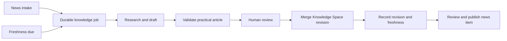

# Graphe de développement des actualités {#news-development-graph}

## Périmètre du contrat {#contract-scope}

Le schéma 1.4 du système d'actualités Happyin relie chaque enregistrement d'actualité relu à un fil de développement de projet ou d'organisation, ainsi qu'à une ressource Knowledge Space lisible par les agents. Les enregistrements des schémas 1.2 et 1.3 restent valides et ne se voient pas attribuer rétroactivement de branches sémantiques.

Quatre dépôts gèrent des étapes distinctes :

| Dépôt | État dont il est responsable |
|---|---|
| `diffusion-love` | Squelettes privés, exécutions des fournisseurs, preuves, décisions de relecture, barrière d'export |
| `diffusion-love-news` | Éléments canoniques publics, JSON Schema, index déterministes |
| `diffusion-love-web` | Présentation en lecture seule du flux, des projets, des organisations et des éléments |
| `knowledge-space` | Références d'implémentation publiques et denses, briefs pour agents |

La dépendance est unidirectionnelle : l'exporteur privé émet un élément public relu, le constructeur public le valide et le matérialise, puis le portail et les agents consomment l'instantané public qui en résulte. Le portail n'écrit jamais l'état d'identité ni celui du graphe.

## Révisions de l'implémentation {#implementation-revisions}

La version du contrat du producteur public est figée à l'adresse [`cd94753d11a86102df942f5560f1f49cdf332ccc`](https://github.com/AnastasiyaW/diffusion-love-news/commit/cd94753d11a86102df942f5560f1f49cdf332ccc). Cette révision ajoute la validation du schéma 1.4, les contrôles de filiation entre enregistrements, l'agrégation des fils de projet et `_organizations.json`, tout en laissant sémantiquement inchangés les 329 éléments canoniques historiques.

Le code source et le déploiement du portail peuvent être soumis à restriction d'accès ; cet article ne les présente donc pas comme des preuves accessibles publiquement. Le contrat côté consommateur est normatif : un consommateur conforme doit valider les mêmes identités et les mêmes arêtes en mode fail-closed, et doit afficher les routes d'actualités, de projets et d'organisations à partir d'un unique instantané immuable du producteur.

## Entités publiques {#public-entities}

### Projet {#project}

`project.family_slug` reste l'identité stable du projet. Les versions de modèles et les adaptations restent au sein de la même famille. Les pages de projets historiques continuent d'utiliser `_projects.json`.

### Organisation {#organization}

`organization.slug` est l'identité stable de l'entreprise ou du propriétaire. Un élément de projet peut inclure à la fois un projet et une organisation ; leur slug de fournisseur et leur nom affiché doivent concorder. Une actualité concernant uniquement une entreprise peut utiliser un objet projet anonyme, mais doit conserver l'identité de l'organisation.

### Fil de développement {#development-thread}

`development` contient :

```json
{
  "scope": "project",
  "thread_slug": "news-knowledge-graph",
  "thread_display": "News and knowledge graph",
  "predecessor_ids": ["n-0123456789"]
}
```

`scope` sélectionne le projet ou l'organisation de le même élément. Les prédécesseurs sont des arêtes de continuation relues, et non des résultats de similarité. Le constructeur public vérifie que chaque prédécesseur existe, qu'il est antérieur dans la chronologie déterministe, et qu'il a le même sujet et le même fil.

Le constructeur matérialise `development_threads` pour les projets ainsi qu'un fichier distinct `_organizations.json`. Cela permet à une page de projet d'afficher des lignes de travail parallèles, et à une page d'organisation de joindre les jalons directs de l'entreprise à ses projets explicitement rattachés.

## Pont vers Knowledge Space {#knowledge-space-bridge}

Chaque élément de schéma 1.4 contient un objet `knowledge` relu :

```json
{
  "title": "News Development Graph",
  "article_url": "https://happyin.space/architecture/news-development-graph/",
  "source_url": "https://raw.githubusercontent.com/AnastasiyaW/knowledge-space/FULL_COMMIT_SHA/docs/architecture/news-development-graph.md",
  "agent_context_url": "https://happyin.space/architecture/news-development-graph/#agent-brief"
}
```

La page rendue offre une navigation stable pour les personnes. `source_url` doit épingler un commit Git complet afin qu'un agent lise le même article que celui relu avec l'enregistrement d'actualité. `agent_context_url` pointe vers l'instruction prête à copier ci-dessous.

Ce brief public destiné aux agents n'est pas un prompt fournisseur. Les prompts d'enrichissement internes, les sorties brutes des fournisseurs et les notes de relecture restent privés et sont rejetés récursivement par le constructeur du flux public.

## État d'exécution {#runtime-status}

Au 2026-08-26, le pont public relu fonctionne pour le premier élément de schéma 1.4 :

- l'élément appartient au fil de développement du projet `diffusion-love` ;
- son Markdown Knowledge Space est épinglé à un commit Git immuable ;
- le portail peut afficher le fil du projet ainsi que les actions article et Agent Brief ;
- les exécutions d'enrichissement privées, les décisions de relecture et l'export public sont enregistrés.

La prochaine boucle de maintenance est **conçue mais pas encore implémentée**. La base de données privée actuelle ne comporte aucune table de ressource Knowledge Space, de tâche de rafraîchissement, de vérification d'article ni de révision. `FRESHNESS.md` définit des fréquences de relecture par domaine, mais le vérificateur de fraîcheur actuel contrôle les décomptes de dépôts, les liens wiki et la synchronisation de `llms.txt`, et non la date de dernière relecture de chaque article.

Cette distinction est opérationnelle : un article immuable lié prouve ce qui a été relu avec un élément d'actualité ; il ne prouve pas qu'un agent a ensuite vérifié l'article à la recherche d'informations plus récentes.

## Cycle cible actualité vers connaissance {#target-news-to-knowledge-cycle}

Chaque intégration d'actualité de schéma 2 acceptée utilisera une référence de ressource Knowledge Space détenue par le curateur et créera une tâche idempotente unique, dans la même transaction de base de données privée que la liaison de la ressource et l'élément d'actualité. L'objet `knowledge` public final n'est matérialisé qu'après qu'une révision Knowledge Space approuvée a fourni un SHA Git complet. Un planificateur calendaire créera le même type de tâche lorsqu'un article atteindra sa date de prochaine vérification, de sorte que le flux de travail ne dépende pas de l'arrivée continue d'actualités.



La tâche est le déclencheur durable. Un appel MCP, une conversation avec un modèle ou une session de navigateur peut se terminer sans que le travail ne soit perdu.

Le registre privé requiert cinq types d'état :

| Enregistrement | Responsabilité |
|---|---|
| Ressource de connaissance | Identité stable projet-ou-organisation/fil-vers-article et projection actuelle de la fraîcheur |
| Liaison d'actualité | Relation exacte entre l'élément, la ressource et la révision approuvée |
| Tâche de connaissance | Déclencheur (actualité, planifié ou manuel), statut du flux de travail et clé de déduplication |
| Exécution de connaissance | Tentative agent/fournisseur en ajout seul, avec empreintes et référence de preuve |
| Révision de connaissance | SHA Git précédent/nouveau, chemins modifiés, relecteur et accusé de fusion |

L'identité d'une ressource est unique sur `(subject_scope, subject_slug, thread_slug)`, où `subject_scope` vaut `project` ou `organization`. Une liaison d'actualité doit correspondre au sujet de développement canonique de l'élément et à son fil. Cela permet aux actualités d'une entreprise de déclencher le même cycle sans faire passer l'entreprise pour un projet intermédiaire.

Une relecture sans changement reste une preuve. Elle met à jour `last_checked_at` et la date de prochaine vérification, mais ne crée pas de commit Git vide et ne modifie pas `last_changed_at`. Une exécution en échec ne fait jamais progresser la fraîcheur. Les éléments d'actualité historiques conservent leur ancienne source adressée par commit, même après qu'une révision planifiée ultérieure a été appliquée à l'article en ligne.

## Contrat d'usage pratique {#practical-use-contract}

Une page de connaissance liée à une actualité doit indiquer à un ingénieur ou à un agent comment appliquer le changement, et pas seulement décrire l'annonce. La barrière de relecture prévue exige :

1. ce qui a changé et la ligne de développement du projet ou de l'entreprise qu'il prolonge ;
2. une commande exécutable, un appel d'API, un flux de travail ou une séquence d'opérations exacte ;
3. quand l'utiliser et quand ne pas l'utiliser ;
4. les versions, prérequis, limites de compatibilité et modes de défaillance ;
5. les détails d'implémentation fondés sur des sources relues ;
6. au moins deux pièges concrets ;
7. un Agent Brief et les révisions exactes des sources.

Les modèles peuvent rédiger ces sections. Ils ne peuvent pas choisir l'identité canonique du projet ou du fil, marquer leur propre production comme relue, ni publier une révision.

## Frontière MCP {#mcp-boundary}

MCP est utile ici comme interface typée pour agents, mais ce n'est ni la base de données, ni le planificateur, ni le moteur de flux de travail.

La conception minimale repose sur deux surfaces ciblées :

### `happyin-context` public {#public-happyin-context}

Un serveur Streamable HTTP en lecture seule et sans état expose des ressources d'actualités, de projets, de Knowledge Space et de fraîcheur adressées par commit. Des outils orientés objectif permettent de rechercher dans les actualités et la connaissance, d'assembler le contexte d'un projet et de construire un contexte compact pour agent à partir d'un identifiant d'actualité. Chaque résultat inclut les SHA exacts du producteur et de Knowledge Space. Il n'expose ni l'état de relecture privé, ni d'outil générique de récupération ou de shell.

L'adresse cible est `https://mcp.happyin.space/mcp`. Elle est publique au sens opérationnel : toute personne ou tout agent peut lister et appeler ses outils en lecture seule sans connexion, OAuth, clé d'API, en-tête personnalisé ni Cloudflare Access. Le déploiement ne lit que des artefacts publics expurgés et ne dispose d'aucune liaison ni d'aucun identifiant pour la base de données privée, les captures brutes, les relectures, les brouillons ou les opérations de publication. Des entrées et sorties bornées, la mise en cache, des délais d'expiration et des réponses `429` visibles protègent le service anonyme sans transformer les limites de débit en système d'identité.

### `happyin-curation` privé {#private-happyin-curation}

Le premier écrivain est un serveur `stdio` local situé à côté du pipeline Python, de la base SQLite privée et des worktrees Git. Des outils typés permettent de lister les travaux, de mettre en file un rafraîchissement idempotent, de préparer un brouillon, d'enregistrer une relecture humaine, d'appliquer une révision Knowledge Space approuvée, de composer un candidat d'actualité et de publier un candidat approuvé. Les actions d'application et de publication restent soumises séparément à approbation.

Les travaux longs sont identifiés par le `job_id` du domaine. L'extension MCP Tasks ne peut refléter ce travail que si le serveur annonce l'extension et si le client y consent via les capacités présentes dans le `_meta` de cette requête. Le handle de tâche est stocké de façon durable et associé à la tâche du domaine avant d'être retourné ; l'interrogation de la tâche durable reste le chemin de compatibilité. L'état entre les appels est explicite plutôt que porté par une session de protocole invisible.

Les pages web externes et les réponses des fournisseurs sont des données non fiables. Elles peuvent étayer des faits, mais ne peuvent pas modifier les permissions, les identités, le choix des outils ni l'état d'approbation. Les sorties d'outils sont des objets stricts et bornés, avec des références de preuve et les prochaines actions valides nommées.

Pour la première connexion privée, utilisez Antigravity IDE avec un fichier `.agents/mcp_config.json` local à l'espace de travail, ou Antigravity CLI pour le même serveur `stdio` local. Cela garde le processus de curation à côté de sa base SQLite et de ses worktrees Git, tout en laissant les journaux de connexion inspectables. Antigravity n'est que le client MCP ; il ne gère pas l'état des tâches. Une fois le point d'accès public en lecture seule déployé, Antigravity 2.0, IDE et CLI peuvent tous s'y connecter via son `serverUrl` distant.

Après le lancement, un utilisateur d'Antigravity n'a besoin que de :

```json
{
  "mcpServers": {
    "happyin-context": {
      "serverUrl": "https://mcp.happyin.space/mcp"
    }
  }
}
```

La publication comprend aussi des configurations prêtes à copier-coller, un `server.json` et une entrée dans le MCP Registry. Le site web reste la source de découverte stable tant que le registre officiel est en préversion.

## Séquence de publication actuelle {#current-publication-sequence}

Tant que la cible de schéma 2 décrite ci-dessus n'est pas implémentée, l'exécution en service reste centrée sur l'article :

1. Rédiger et valider l'article Knowledge Space.
2. Le fusionner et enregistrer l'URL Markdown exacte adressée par commit.
3. Ingérer un squelette d'actualité avec les références projet/organisation, développement et connaissance.
4. Enrichir uniquement via un fournisseur explicitement sélectionné ou une exécution de preuve manuelle relue.
5. Composer et inspecter le candidat public complet.
6. Enregistrer une décision de relecture humaine explicite.
7. Exporter l'élément canonique et reconstruire tous les index publics générés.
8. Vérifier le commit exact du producteur, la validation CI et les routes authentifiées du portail.

Publier l'article seul ne publie pas d'élément d'actualité. Exporter un candidat privé seul ne met pas à jour le flux public. Une réponse de CDN adressée par branche ne constitue pas la preuve d'un instantané cohérent unique.

## Agent Brief {#agent-brief}

Copiez cette instruction à un agent avec l'URL de l'actualité Happyin concernée :

```text
Read the linked Happyin news item and this Knowledge Space article. Treat the
news item's project, organization, development thread, predecessor IDs and
commit-addressed knowledge source as the authoritative public graph. Explain:
1. what changed;
2. which project or company development line it continues;
3. how a user or agent can apply the changed capability, including prerequisites,
   an exact operating sequence and the main failure modes;
4. how the implementation works across the private pipeline, public builder,
   portal and Knowledge Space;
5. which claims are verified, reported or inferred;
6. the exact source revisions that support the answer.

Do not infer missing graph edges from similar titles, tags or embeddings. Do
not treat a mutable branch URL or a current live page as historical proof. If
the immutable source or referenced predecessor cannot be retrieved, state the
missing evidence instead of filling the gap.
```

## Règles de validation {#validation-rules}

- Les slugs d'identité sont en kebab-case minuscule et sont relus avant l'export.
- Un fil de développement appartient à exactement un projet ou une organisation.
- Les arêtes prédécesseurs entre sujets différents, entre fils différents, manquantes ou pointant vers l'avant échouent en mode fail-closed.
- Le Markdown Knowledge Space utilise une URL de commit Git complet et immuable.
- Le flux public ne contient que des URL vers le contexte agent, jamais le texte d'un prompt interne.
- Le JSON dérivé est reconstruit à partir des fichiers d'éléments et n'est jamais modifié à la main.

## Pièges courants {#gotchas}

- **Une actualité similaire n'est pas une continuation :** la recherche et les embeddings peuvent suggérer une arête candidate. **Correction :** ne publier que les identifiants de prédécesseurs approuvés par le relecteur.
- **Un nom d'entreprise n'est pas une identité :** les changements d'orthographe et de marque créent des pages en double. **Correction :** utiliser un seul slug canonique d'organisation et rejeter les métadonnées contradictoires lors de l'agrégation.
- **Une page web stable n'est pas une entrée immuable :** son contenu peut changer après la relecture d'une actualité. **Correction :** associer la page à un Markdown adressé par commit.
- **Le contexte agent peut être confondu avec les prompts d'enrichissement :** assouplir les contrôles de confidentialité exposerait des données internes. **Correction :** continuer à interdire les clés de prompt internes et ne publier que les URL d'articles relus.

## Voir aussi {#see-also}

- [[news-research-knowledge-lifecycle]]
- [[happyin-knowledge-space]]
- [[architecture-documentation]]
- [[data-serialization-formats]]
- [[agent-architectures]]
- [[transactional-outbox]]
- [[function-calling]]

## Références de protocole {#protocol-references}

- [Version MCP 2026-07-28](https://blog.modelcontextprotocol.io/posts/2026-07-28/)
- [Extension MCP Tasks](https://github.com/modelcontextprotocol/modelcontextprotocol/blob/main/docs/extensions/tasks/overview.mdx)
- [SDK Python MCP officiel v2](https://py.sdk.modelcontextprotocol.io/)
- [Recommandations Cloudflare pour les serveurs MCP distants](https://developers.cloudflare.com/agents/model-context-protocol/guides/remote-mcp-server/)
- [Contrôles des points d'accès MCP publics Cloudflare](https://developers.cloudflare.com/ai-search/how-to/connect-mcp-client/)
- [Intégration MCP du SDK OpenAI Agents](https://openai.github.io/openai-agents-python/mcp/)
- [Configuration MCP de Google Antigravity](https://antigravity.google/docs/mcp)
- [Serveurs distants du registre MCP](https://modelcontextprotocol.io/registry/remote-servers)
