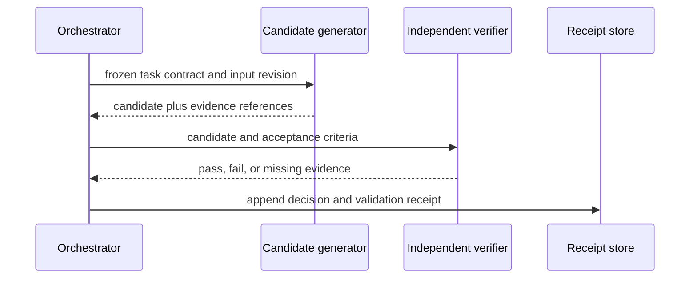
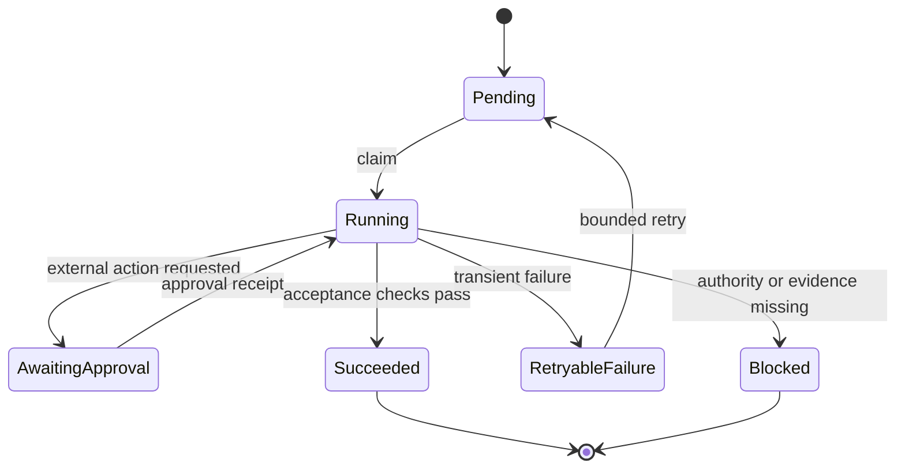

# Diagrammes as Code pour les workflows d'agents {#diagram-as-code-for-agent-workflows}

**Périmètre vérifié : 2026-09-04.** Un diagramme est utile lorsqu'il rend inspectable une transition d'état, un transfert, une approbation ou une frontière de confiance autrement cachés. Conservez la source du diagramme à côté du système qu'il décrit, mais ne supposez pas qu'un même moteur de rendu Markdown, un même site d'hébergement ou une même notation prennent en charge toutes les fonctionnalités des diagrammes.

## Diagrammer la frontière floue {#diagram-the-unclear-boundary}

Commencez par une question concrète plutôt que par un type de diagramme :

| Question | Diagramme utile le plus simple |
|---|---|
| Quel rôle envoie quel artefact, et dans quel ordre ? | diagramme de séquence |
| Dans quels états une tâche peut-elle entrer, être relancée ou échouer définitivement ? | diagramme d'états |
| Quel composant peut appeler quel outil ou quel service ? | diagramme de contexte ou de frontière de confiance |
| Quelles données traversent une frontière de permission, de tenant ou de réseau ? | diagramme de flux de données ou de déploiement |
| Quelle politique contrôle une décision ? | table de décision, éventuellement associée à un diagramme d'états |

Ne diagrammez pas un simple utilitaire uniquement parce qu'un outil de diagrammes est disponible. Préférez un test, un contrat ou une courte table lorsque ceux-ci expriment le comportement plus directement.

## Diagramme de séquence : rendre les transferts visibles {#sequence-diagram-make-handoffs-visible}

Cet exemple Mermaid décrit un flux de revue borné. Il décrit le protocole visé ; le code et les tests référencés doivent encore prouver que ce protocole est implémenté.

Les diagrammes de séquence sont efficaces lorsque l'ordre des messages compte. Ils doivent nommer l'artefact transmis, et non simplement le libellé de l'agent. Mermaid documente la syntaxe des diagrammes de séquence ; PlantUML traite de même les définitions textuelles de participants et de messages comme une source que le moteur de rendu transforme en diagramme. [Diagrammes de séquence Mermaid](https://mermaid.js.org/syntax/sequenceDiagram) · [Diagrammes de séquence PlantUML](https://plantuml.com/sequence-diagram)

## Diagramme d'états : rendre les états terminaux explicites {#state-diagram-make-terminal-states-explicit}

Pour les agents, un diagramme d'états est souvent plus utile qu'un grand diagramme de classes, car les relances, les approbations et les états d'échec terminal sont opérationnellement importants.

Un état terminal « blocked » n'est pas une erreur dissimulée derrière une boucle de relance. Il indique aux opérateurs quelle preuve, quelle approbation ou quelle condition externe est requise avant que le travail puisse reprendre. Validez la syntaxe exacte des états avec le moteur de rendu de votre chaîne documentaire. [Diagrammes d'états Mermaid](https://mermaid.js.org/syntax/stateDiagram.html) · [Diagrammes d'états PlantUML](https://plantuml.com/state-diagram)

## Garder une frontière de confiance séparée {#keep-a-trust-boundary-separate}

Un diagramme de workflow peut suggérer des permissions sans les montrer. Ajoutez une vue compacte de frontière ou une table pour les décisions qui impliquent des identifiants, des données utilisateur, des appels réseau ou une publication.

| Frontière | Flux autorisé | Preuve requise |
|---|---|---|
| saisie utilisateur vers planificateur | lue comme donnée non fiable | enregistrement de la saisie et version de la politique |
| planificateur vers exécuteur d'outil | uniquement les paramètres d'outil déclarés | décision de permission et reçu de l'outil |
| exécuteur d'outil vers service externe | requête approuvée et délimitée | clé d'idempotence et réponse du service |
| brouillon généré vers publication | contenu approuvé par le propriétaire uniquement | reçu de revue et de publication |

Le [modèle C4](https://c4model.com/) est utile comme vocabulaire pour le contexte logiciel, les conteneurs, les composants et le code. Il ne remplace pas une revue de sécurité explicite, et il ne choisit pas à votre place un moteur de rendu.

## Choisir une notation selon le contrat de publication {#select-a-notation-by-the-publishing-contract}

- **Mermaid :** à utiliser lorsque la syntaxe requise est prise en charge par le moteur de rendu réel de la documentation et par sa validation CI.
- **PlantUML :** à utiliser lorsque le projet dispose d'un chemin de rendu déclaré pour les sources ou les ressources générées en PlantUML.
- **C4 :** à utiliser pour la communication d'architecture hiérarchique, indépendamment du moteur de rendu de diagrammes choisi.
- **Terminologie UML :** à utiliser uniquement lorsque sa sémantique aide l'équipe à communiquer ; un diagramme d'apparence formelle ne remplace pas des critères d'acceptation exécutables.

Vérifiez la syntaxe officielle actuelle avant de vous appuyer sur une fonctionnalité, et évitez de publier des affirmations du type « natif partout » ou un nombre fixe de types de diagrammes pris en charge. Les moteurs de rendu, les extensions et les intégrations d'hébergement évoluent indépendamment.

## Workflow de vérification {#verification-workflow}

1. conserver la source avec la révision pertinente de la spécification ou du code ;
2. nommer le moteur de rendu cible et la commande qui le valide ;
3. effectuer le rendu dans la même CI ou le même chemin de site statique que celui qui publie la page ;
4. traiter les échecs comme des défauts de documentation, et non comme des avertissements cosmétiques ;
5. mettre à jour le diagramme chaque fois qu'un état, un message ou une frontière de confiance testé change.

Pour un flux à haut risque, associez le diagramme à un test de machine à états, à un contrat d'API ou à un test de politique d'approbation. Le diagramme aide les personnes à raisonner sur le système ; le contrôle exécutable détermine si une révision préserve le contrat.

## Modes de défaillance courants {#common-failure-modes}

- **Hypothèse sur le moteur de rendu :** un fichier source valide est pris pour la preuve que le site publié peut le rendre.
- **Flux du chemin nominal uniquement :** les relances, l'annulation, le refus et le blocage terminal disparaissent du diagramme.
- **Autorité implicite :** les flèches laissent entendre qu'un agent peut appeler un système sans montrer la frontière d'approbation.
- **Dérive du diagramme :** l'image survit à un changement de code parce qu'aucune validation ni revue ne la relie à la révision.
- **Culte de la notation :** un diagramme complexe masque un test d'acceptation ou une table de décision plus simple.

## Références {#references}

- [Syntaxe des diagrammes de séquence Mermaid](https://mermaid.js.org/syntax/sequenceDiagram)
- [Syntaxe des diagrammes d'états Mermaid](https://mermaid.js.org/syntax/stateDiagram.html)
- [Documentation des diagrammes de séquence PlantUML](https://plantuml.com/sequence-diagram)
- [Documentation des diagrammes d'états PlantUML](https://plantuml.com/state-diagram)
- [Modèle C4](https://c4model.com/)
